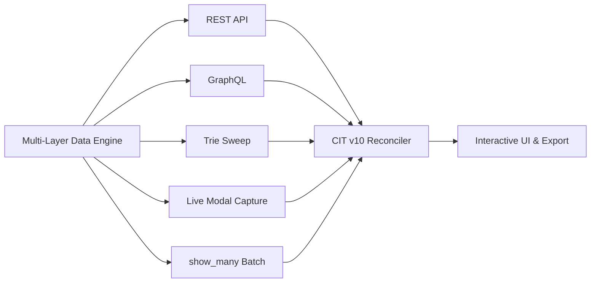

# Instagram Follow Checker Pro v30.8

[<kbd>License: MIT</kbd>](LICENSE) [<kbd>Tampermonkey: Userscript</kbd>](#installation--usage) [<kbd>JavaScript: ES2022</kbd>](#about-the-project)

Advanced Tampermonkey/Violentmonkey userscript for Instagram follower analytics with **CIT v10 integrity engine**, REST/GraphQL/Trie sweep, live modal capture, and anti-ban quotas.

---

## About the Project

**Instagram Follow Checker Pro** is a comprehensive browser-based analytics userscript designed for both your own account and private accounts you follow. Powered by the **CIT v10 (Cross-Integrity & Triangulation)** engine, it eliminates discrepancies caused by Instagram API pagination limits and caching.

### Key Features

- **CIT v10 Integrity Engine:** Multi-layer verification combining REST API, GraphQL queries, Trie prefix sweep, Live Modal DOM capture, and `show_many` batch reconciliation.
- **Private & Own Account Support:** Seamlessly analyze your own profile as well as private accounts you follow.
- **Suspicious / Bot Detection:** Heuristic scoring and flagging for inactive, ghost, or suspected bot accounts.
- **Account Management:** Built-in protection/whitelist, favorites, custom notes, and user tags.
- **Customizable Interface:** 6 distinct UI themes with full **Turkish (TR)** and **English (EN)** language support.
- **Anti-Ban Quotas & Cooldowns:** Smart request pacing, hourly/daily quota management, and automatic break intervals to keep your account safe.
- **Data Portability:** Export results to **CSV**, **JSON**, and **TXT**, plus import support for official **Instagram JSON** data exports.

---

## Architecture

---

## Installation & Usage

1. Install the **Tampermonkey** or **Violentmonkey** browser extension for Chrome, Firefox, Edge, or Safari.
2. Open your userscript manager dashboard and click **Create a new script** (or **+**).
3. Copy the contents of `instagram-follow-checker-pro.user.js` and paste it into the editor, then save (`Ctrl+S` / `Cmd+S`).
4. Navigate to `instagram.com` and log into your account.
5. Open any profile (yours or a followed private account) and launch the **Instagram Follow Checker Pro** panel from the floating action button or userscript menu.

---

## Keyboard Shortcuts

| Shortcut | Action |
| :--- | :--- |
| `Enter` | Confirm action / Start or resume scan |
| `/` | Focus search / filter bar |
| `1` – `9` | Quick switch between tabs and filter presets |
| `Shift + Click` | Range-select multiple accounts in the list |
| `Esc` | Close active modal or dismiss overlay |

---

## License

This project is licensed under the **MIT License** — see the [LICENSE](LICENSE) file for details., live modal capture, and anti-ban quotas.
