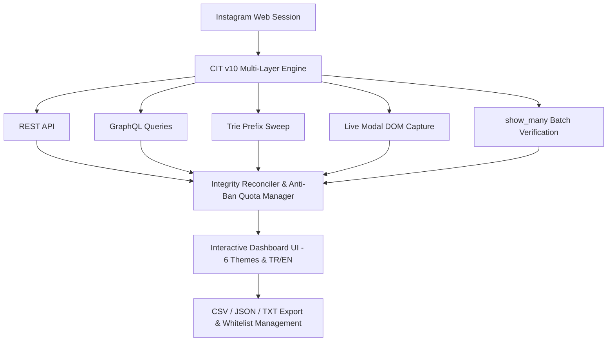

# 📊 Instagram Follow Checker Pro

### (Advanced Instagram Follower & Following Integrity Analyzer)

[](https://opensource.org/licenses/MIT)
[](#)

A high-precision browser userscript powered by the **CIT v10 Integrity Engine** to analyze Instagram followers, non-followers, mutuals, ghost/bot accounts, and private profiles with built-in anti-ban protection, multi-theme UI, and full TR/EN localization.

---

## 📚 Table of Contents

- [About the Project](#about-the-project)
- [Architecture](#architecture)
- [Features](#features)
- [Technologies Used](#technologies-used)
- [Installation & Usage](#installation--usage)
- [Project Structure](#project-structure)
- [Keyboard Shortcuts](#keyboard-shortcuts)
- [Disclaimer](#disclaimer)
- [Development Process](#development-process)
- [Contributing](#contributing)
- [Contact](#contact)
- [License](#license)

---

## About the Project

Instagram Follow Checker Pro is a client-side userscript designed to accurately audit follower and following relationships on `instagram.com` without relying on third-party servers or credential sharing. By combining five independent verification layers under the **CIT v10** engine and enforcing smart anti-ban quotas and cooldowns, it delivers reliable results for both personal profiles and followed private accounts.

- **Developer:** Haluk Can SARIÖZ
- **Version:** 30.8

---

## Architecture



---
## Features

- **CIT v10 Integrity Engine** — Multi-layer verification combining REST API, GraphQL queries, Trie prefix sweep, Live Modal DOM capture, and `show_many` batch reconciliation for maximum accuracy.
- **Anti-Ban Quota & Cooldown System** — Smart request pacing, hourly/daily quota management, and automatic break/cooldown intervals to keep your account safe.
- **Private & Own Account Support** — Seamlessly analyze your own profile as well as private accounts you follow.
- **Suspicious / Bot Detection** — Heuristic scoring and flagging for inactive, ghost, or suspected bot accounts.
- **Account Management** — Built-in protection/whitelist, favorites, custom notes, and user tags.
- **6 Distinct UI Themes & TR/EN Support** — Customizable interface with 6 selectable themes and full **Turkish (TR)** and **English (EN)** language support.
- **Data Portability** — Export scan results to **CSV**, **JSON**, and **TXT**, plus import support for official **Instagram JSON** data exports.

---

## Technologies Used

- **JavaScript (ES6+)** — Core userscript logic, state management, and asynchronous API orchestration.
- **Tampermonkey / Violentmonkey API** — Browser userscript runtime integration (`GM_*` storage and menu commands).
- **Instagram REST & GraphQL APIs** — Client-authenticated data retrieval and `show_many` batch verification.
- **DOM MutationObserver & Trie Search** — Live modal capture and prefix-based follower/following sweep.
- **CSS3 Custom Properties** — Dynamic theming engine powering 6 distinct visual themes.

---

## Installation & Usage

1. Install the **Tampermonkey** or **Violentmonkey** browser extension for Chrome, Firefox, Edge, or Safari.
2. Open your userscript manager dashboard and click **Create a new script** (or **+**).
3. Copy the contents of `instagram-follow-checker-pro.user.js` and paste it into the editor, then save (`Ctrl+S` / `Cmd+S`).
4. Navigate to `instagram.com` and log into your account.
5. Open any profile (yours or a followed private account) and launch the **Instagram Follow Checker Pro** panel from the floating action button or userscript menu.

---

## Project Structure

```text
Instagram-Follow-Checker-Pro/
├── CHANGELOG.md
├── LICENSE
└── README.md
```

---

## Keyboard Shortcuts

| Shortcut | Action |
| :--- | :--- |
| `Enter` | Confirm action / Start or resume scan |
| `/` | Focus search / filter bar |
| `1` – `9` | Quick switch between tabs and filter presets |
| `Shift + Click` | Range-select multiple accounts in the list |
| `Esc` | Close active modal or dismiss overlay |

---

## Disclaimer

This tool operates strictly within your active browser session on `instagram.com` and never transmits your credentials or data to external servers. Use the built-in anti-ban quota and cooldown settings responsibly; automated scraping or excessive request rates may trigger temporary rate limits on Instagram.

---

## Development Process

### 1. Fork the Repository
Click the **Fork** button at the top right of this repository to create your own copy.

### 2. Create a New Branch
```bash
git checkout -b feature/your-feature-name
```

### 3. Push Your Code
```bash
git add .
git commit -m "Add: brief description of your changes"
git push origin feature/your-feature-name
```

---

## Contributing

1. Fork the repository.
2. Create a feature branch (`git checkout -b feature/amazing-feature`).
3. Commit your changes (`git commit -m "Add: amazing feature"`).
4. Push to the branch (`git push origin feature/amazing-feature`).
5. Open a Pull Request.

---

<a name="contact"></a>

## Contact

**Haluk Can Sarıöz**

- GitHub: [@halukcansarioz](https://github.com/halukcansarioz)
- Email: [halukcansarioz19@gmail.com](mailto:halukcansarioz19@gmail.com)
- LinkedIn: [Haluk Can Sarıöz](https://www.linkedin.com/in/halukcansarioz)

**Project Link:** [https://github.com/halukcansarioz/Instagram-Follow-Checker-Pro](https://github.com/halukcansarioz/Instagram-Follow-Checker-Pro)

---

## License

This project is licensed under the [MIT License](LICENSE).
